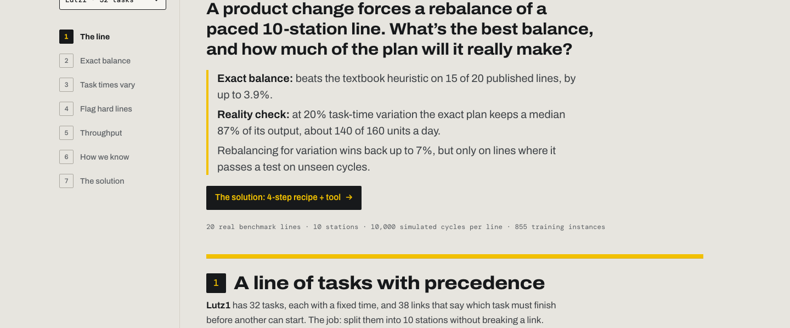
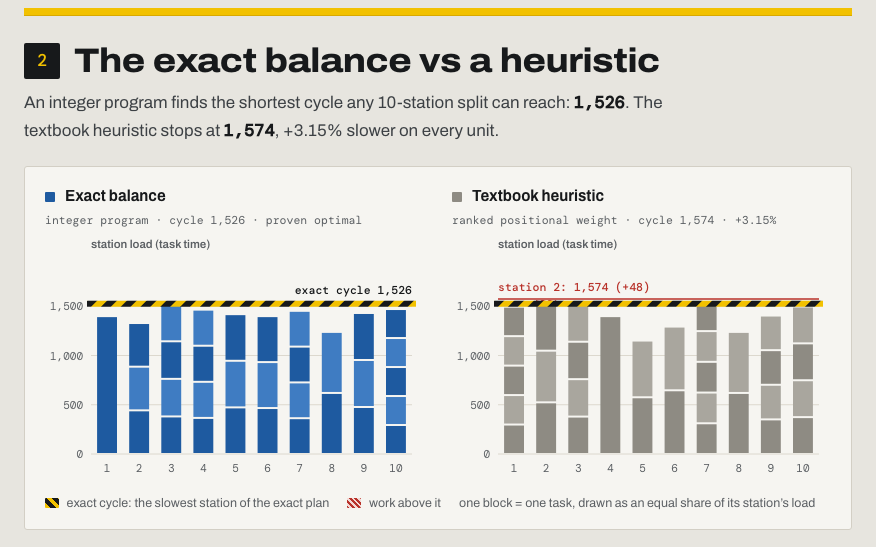
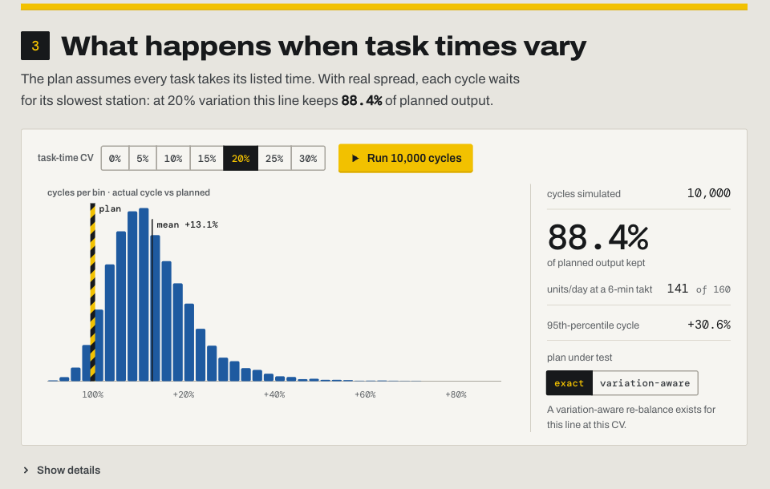
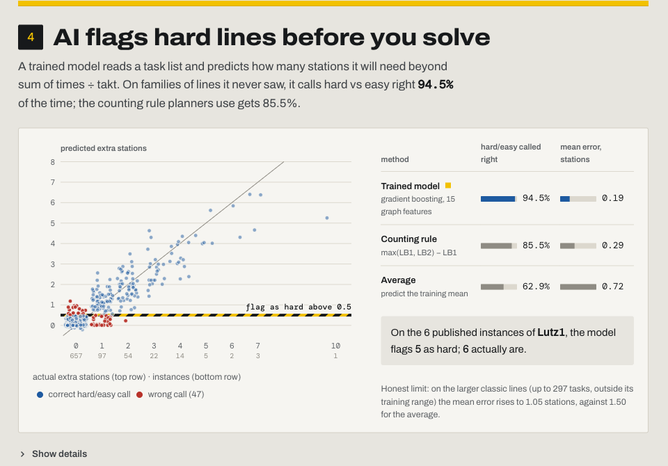
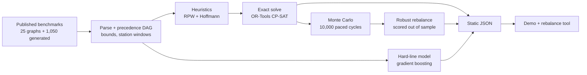

# Takt Line Balancer

**Exact balancing for paced assembly lines, and a measured answer to how much of the plan the line will really make.**

[](tests)
[](LICENSE)
[](#data-and-credit)
[](pipeline)
[](src)

<p align="center">
  <a href="https://ibiraheel.com/demos/takt-line-balancer/"></a>
</p>

<p align="center"><b><a href="https://ibiraheel.com/demos/takt-line-balancer/">Live demo</a></b> · <a href="METHOD.md">Method</a> · <a href="SOLUTION.md">Solution playbook</a></p>

---

## The question

A product change forces a rebalance of a paced 10-station line. What is the best balance, and how much of the planned output survives once task times vary?

## The answer

Measured on 20 published benchmark lines:

- An exact solver beat the textbook heuristic on **15 of 20 lines**, by up to **3.9%** on cycle time.
- Even the exact plan kept a median **87%** of its output at 20% task-time variation: about **140 of 160 units a day**.
- A variation-aware rebalance won back up to **7%**, but only on 6 of 17 lines, so it has to pass a test on unseen cycles before anyone moves a fixture.

## The solution

A short rebalance recipe with decision rules ([SOLUTION.md](SOLUTION.md)) and a one-command tool that returns the decision: the exact plan, units a day planned vs expected, the station to fix first, and whether to adopt the variation-aware plan.

```bash
python -I pipeline/rebalance.py "$HOME/Developer/job-hunt-builds/_downloads/salbp/s1993/precedence graphs/KILBRID.IN2" \
    --stations 10 --cv 0.20 --takt-s 360
```

```
KILBRID: 45 tasks, 10 stations, task-time CV 20%
  exact plan      cycle 56 (proven), efficiency 98.6%
  station loads   [56, 55, 53, 55, 56, 56, 55, 54, 56, 56]
  heuristic       cycle 57 (+1.79% left on the table)
  realistic rate  keeps 84.7% of output, p95 cycle 497 s -> 160 planned vs 135 expected units/day
  fix first       S4 19%, S5 17%, S6 10%  (share of cycles each station sets the pace)
  robust          KEEP exact plan (variation-aware +0.00% on unseen cycles)
```

It reads the benchmark `.IN2` format (task count, one time per task, then `i,j` precedence pairs), so a time-study export maps straight onto it.

## Key results

| Measure | Result |
|---|---|
| Exact vs ranked-positional-weight heuristic, 10 stations, 20 lines | Heuristic cycle longer on 15 of 20; median +1.56%, worst +3.87% |
| Exact vs heuristic, 269 SALBP-1 instances | Heuristic needs extra stations on 102 instances (128 stations in total) |
| 10-station balance efficiency | Median 99.1%, lowest 79.0% |
| Output kept under task-time variation (median of 20 lines) | CV 0.10: 93.7% · CV 0.20: 87.2% · CV 0.30: 81.1% |
| Same at a 6-min takt, 16 h/day (160 planned) | About 150, 140 and 130 units a day |
| Solver vs 268 published SALBP-1 optima | 213 matched exactly, 188 proven, none beaten |
| Solver vs 15 published 10-station optima | 13 matched exactly, the other two within 0.07% |

Every number comes from `public/data/*.json`, written by `pipeline/run_all.py`. Derivations and validation are in [METHOD.md](METHOD.md).

<p align="center">
  
  
</p>

## AI vs baseline

Two comparisons, both scored on data the method never saw.

**Hard-line predictor.** Gradient boosting on 15 task-graph features predicts how many stations a line needs beyond `sum of times / takt`. It is scored with grouped cross-validation on 855 generated instances, so every test fold is a generator family the model never trained on.

| Method | Mean error (stations) | Hard/easy called right | Verdict |
|---|---|---|---|
| Gradient boosting | **0.19** | **94.5%** | **Win** |
| Counting rule `max(LB1, LB2) - LB1` | 0.29 | 85.5% | |
| Predict the training mean | 0.72 | 62.9% | |
| Out of range: 268 larger classic instances | 1.05 (mean baseline 1.50) | | Win, but much weaker |

**Variation-aware rebalance vs exact plan.** Optimised on 60 sampled scenarios, then both plans run on the same fresh 10,000 cycles.

| At 20% task-time CV, 17 lines | Lines | Range |
|---|---|---|
| Variation-aware plan better | 6 | up to +7.1% output |
| Equal | 5 | |
| Variation-aware plan worse | 6 | down to -0.53% |

Overall a tie. It pays off on lines with a few long, variable tasks and overfits elsewhere, which is why the tool adopts it only when the out-of-sample gain is above 0.5%.

<p align="center">
  
</p>

## How it works



1. **Parse.** `.IN2` and `.alb` files become a precedence DAG with capacity and counting bounds and per-task station windows.
2. **Bound.** Ranked positional weight and Hoffmann maximum-load filling give the upper bound and the solver hint.
3. **Solve.** CP-SAT proves the optimum or improves on the heuristic (SALBP-1: fewest stations; SALBP-2: shortest cycle at 10 stations).
4. **Stress-test.** Lognormal task times, cycle = slowest station, 10,000 cycles per line and CV. The station that sets each cycle gives its blocking share.
5. **Predict.** A gradient-boosted model flags task lists that will need more stations than `sum of times / takt`.
6. **Export.** Everything lands in static JSON. The demo only reads those files, so it needs no backend or API keys.

## Quickstart

```bash
# Python 3.11+
pip install ortools networkx numpy scipy scikit-learn openpyxl pytest

python -I pipeline/fetch_data.py            # downloads the benchmarks to ~/Developer/job-hunt-builds/_downloads/salbp
python -I pipeline/run_all.py --stage all   # about 15 minutes on 2 cores; writes public/data/*.json
python -I -m pytest -q tests                # 29 tests (14 need the downloaded data)

# the decision tool on one benchmark line (about 25 s with the robust check)
python -I pipeline/rebalance.py "$HOME/Developer/job-hunt-builds/_downloads/salbp/s1993/precedence graphs/KILBRID.IN2" \
    --stations 10 --cv 0.20 --takt-s 360

# the demo
npm install
npm run dev        # http://localhost:5173/demos/takt-line-balancer/
npm run build      # static site in dist/, built for the /demos/takt-line-balancer/ path
```

Set `SALBP_DATA=/path/to/folder` (or pass a destination to `fetch_data.py`) to keep the data elsewhere. Stages can be re-run on their own: `--stage salbp1|salbp2|mc|ml|biz|export`.

## Repo layout

```
pipeline/
  alb.py          parsers, precedence DAG, bounds, station windows, graph features
  heuristic.py    ranked positional weight and Hoffmann heuristics
  solve.py        CP-SAT models: SALBP-1, SALBP-2, sample-average robust rebalance
  montecarlo.py   paced-line simulation and blocking shares
  rebalance.py    the one-command decision tool
  run_all.py      runs every stage, exports public/data/*.json
  fetch_data.py   downloads the benchmarks
tests/            29 pytest tests (hand calculation, published optima, sampler, tool)
public/data/      precomputed, derived results the demo reads (no raw benchmark data)
src/              React + TypeScript demo
METHOD.md         equations, assumptions, validation, limitations
SOLUTION.md       the rebalance recipe, decision rules and week-1 plan
```

## Data and credit

Real public benchmark data. `pipeline/fetch_data.py` downloads it from the publisher into a folder outside this repository (default `~/Developer/job-hunt-builds/_downloads/salbp`, or set `SALBP_DATA`); the pipeline, the tests and the rebalance tool read it from there. **The benchmark files are not redistributed:** no per-task times, precedence links or original files are in this repository or the demo. Only derived results ship in `public/data/*.json`: cycle times and station counts, station loads, the station each task is assigned to, simulated throughput, and the model's outputs, plus per-line summary statistics: the number of tasks and links, the total and longest task time, and order strength.

- Scholl, A. (1993). *Data of assembly line balancing problems.* TU Darmstadt. Includes graphs from Talbot, Patterson & Gehrlein (1986) and Hoffmann (1990, 1992). 25 precedence graphs, 269 SALBP-1 and 302 SALBP-2 instances.
- Otto, A., Otto, C. & Scholl, A. (2013). SALBPGen: a systematic data generator for (simple) assembly line balancing. *European Journal of Operational Research* 228, 33-45. The n = 20 and n = 50 sets.

Both are published at [assembly-line-balancing.de](https://assembly-line-balancing.de) for research use; no licence text is stated, which is why they are fetched rather than copied. The always-on unit tests use a small original 9-task line; the checks against published values (Jackson and the full benchmark) run when the downloaded data is present. Task-time variation is in no public dataset, so the coefficient of variation is a labelled assumption, as are the 6-minute takt and 16 h/day used to express results in units a day.

The code in this repository is MIT licensed.

## Limitations

- **Variation is assumed.** One CV for every task, tasks independent. Real lines have task-specific and correlated variation, operator learning and buffers, none of which are modelled.
- **Paced and unbuffered is the worst case.** Buffers between stations would recover part of the lost output.
- **SALBP leaves out the shop floor.** Zoning, tooling, ergonomics and walking are not constraints here, and a real balance must respect them.
- **Not every large instance is proven.** CP-SAT gets a few seconds per instance; 55 of 268 SALBP-1 results sit 1 or 2 stations above the published optimum, mostly on the largest graphs. Unproven results are flagged.
- **The predictor is trained on small graphs.** Training instances have 20 to 50 tasks; on larger real graphs its error rises from 0.19 to 1.05 stations.

## Author

Built by **Ibi Raheel**, a mechanical engineer who builds AI tools. More work at [ibiraheel.com](https://ibiraheel.com).
